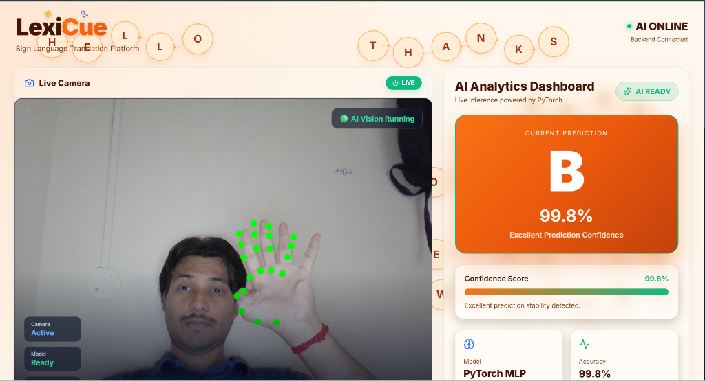
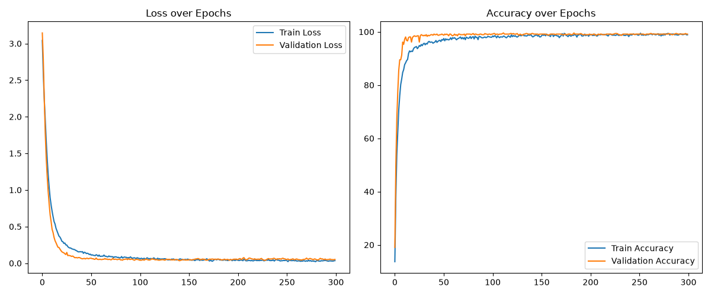

<div align="center">
  <h1>🤟 LexiCue</h1>
  <h3>Bridging the Silence: 100% Offline, Real-Time ASL Translation</h3>
  
  <p align="center">
    <strong>A high-performance, privacy-first American Sign Language (ASL) translator powered by PyTorch and MediaPipe.</strong>
  </p>
</div>

---

## 🌍 The Cause: Why We Built LexiCue

Over **70 million deaf people** around the world use sign language as their primary means of communication. However, the majority of the hearing population does not know sign language, creating a massive daily communication barrier.

While some AI translation tools exist, they almost always rely on **cloud APIs**. This requires constant internet access, introduces frustrating lag, and raises serious privacy concerns (streaming video of your home and face to third-party servers).

**LexiCue** addresses this by being entirely **local, offline, and instant.** It empowers the Deaf and Hard of Hearing community to communicate naturally and privately, while providing a frictionless, real-time learning tool for those wanting to learn ASL.

---

## 📸 Screenshots

<div align="center">
  
  <p><i>The LexiCue UI in action, seamlessly detecting hand landmarks and predicting signs in real-time.</i></p>
</div>

---

## 🧠 How It Works Under the Hood

LexiCue doesn't just guess what you're signing; it uses a multi-stage, physics-aware AI pipeline:

1. **3D Hand Tracking (MediaPipe):** The React frontend captures webcam feed at 60fps. MediaPipe WebAssembly extracts 21 precise 3D joints (x, y, z coordinates) from your hand.
2. **Spatial Normalization:** The frontend calculates your wrist position and the maximum span of your hand. It shifts all 21 points to be relative to your wrist and scales them down to a standardized `0.0` to `1.0` distance. This ensures the AI works perfectly whether you are 1 foot or 10 feet away from the camera!
3. **Deep Learning Inference (PyTorch):** The normalized array of 63 coordinates is blasted over WebSockets to a local Python FastAPI server. It is fed into a custom **Multilayer Perceptron (MLP)** PyTorch neural network that outputs a confidence score for all 26 letters.
4. **Physical Geometry Overrides:** Because a static 2D frame can make a "D", "L", and "Z" look identical to an AI, LexiCue injects **Geometric Reasoning**. The backend physically measures the Euclidean distance between your Thumb Tip and Middle Finger Tip in 3D space to flawlessly distinguish identical-looking signs, overriding the neural network when necessary.

---

## 📊 AI Model Performance & Metrics

We trained a custom PyTorch Neural Network strictly on hand-landmark spatial data. Because the input is just coordinates (not raw pixels), the model is incredibly lightweight, blazing fast, and highly accurate.

* **Architecture:** Input(63) -> Linear(128) -> BatchNorm -> Dropout -> Linear(64) -> Output(26)
* **Final Test Accuracy:** **99.14%**
* **Epochs:** 300 (Adam Optimizer)

### Training Accuracy & Loss
*(Graphs automatically generated during model training)*



### Confusion Matrix
LexiCue rarely confuses letters, as proven by a near-perfect diagonal confusion matrix on the holdout test set.


---

## ✨ Key Features

- **⚡ Real-Time Tracking:** Sub-millisecond inference speeds.
- **🛠️ Teach Mode:** A dynamic Nearest-Neighbor engine allows users to teach the AI brand new custom signs or words in seconds, without retraining the PyTorch base model. (Perfect for shaky hands, featuring a custom cooldown system).
- **🪄 Smart AI Sentence Formatting:** Automatically separates run-on letters (e.g., "iloveyou" ➡️ "I love you") using offline NLP (`wordninja`).
- **📖 Instant Offline Dictionary:** Integrated offline `NLTK WordNet`. Build a sentence, click "Meaning," and get educational definitions for every word you signed instantly without an internet connection.
- **🗣️ Text-to-Speech:** Click "Speak" to have your browser vocalize your signed sentence.
- **🎨 Glass-morphism UI:** Built with React, Vite, and Framer Motion for a stunning, accessible dashboard experience.

---

## 💻 Tech Stack

* **Frontend:** React 18 (Vite), TypeScript, Framer Motion, MediaPipe Tasks Vision, Lucide React.
* **Backend:** Python 3, FastAPI, Uvicorn, WebSockets.
* **Machine Learning:** PyTorch, Scikit-learn, Matplotlib, Seaborn.
* **NLP & Text Processing:** NLTK (WordNet), Wordninja.

---

## 🚀 Getting Started

Because LexiCue prioritizes your privacy, it runs entirely locally in two parts:

### 1. Start the Python Backend
Open a terminal and navigate to the project root:
```bash
cd asl-translator-mvp/backend

# Install the required Python dependencies
pip install fastapi uvicorn websockets torch torchvision pandas numpy scikit-learn matplotlib seaborn wordninja nltk

# (First run only) Download the offline dictionary
python -c "import nltk; nltk.download('wordnet')"

# Run the backend server
python -m uvicorn app.main:app --reload --host 127.0.0.1 --port 8000
```

### 2. Start the React Frontend
Open a **second** terminal and navigate to the frontend folder:
```bash
cd asl-translator-mvp/frontend

# Install Node dependencies
npm install

# Start the Vite development server
npm run dev
```
Click the local link provided by Vite (usually `http://localhost:5173`) to open LexiCue in your browser!

---
<div align="center">
  <i>Built with ❤️ for a more accessible world.</i>
</div>
